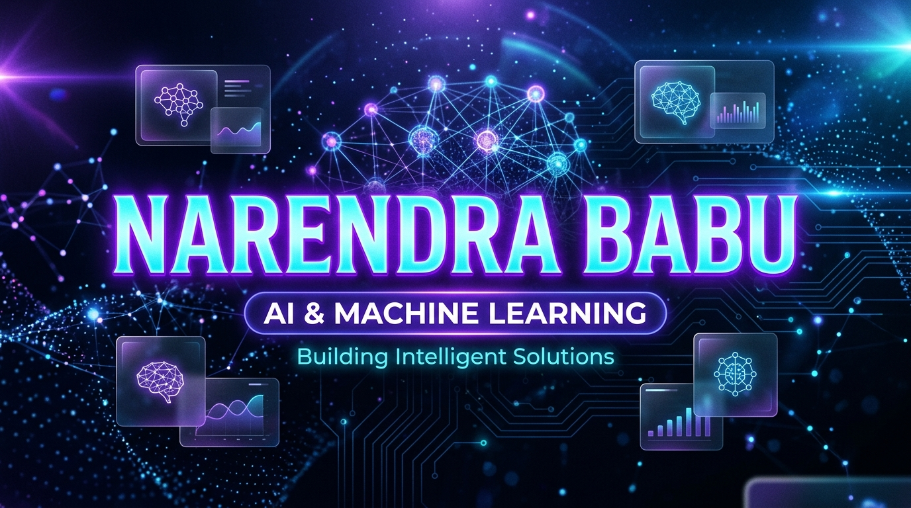

# Chappidi Venkata Narendra Babu — Portfolio



<p align="center">
  <strong>AI &amp; Machine Learning Student · Building Intelligent Solutions</strong>
</p>

<p align="center">
  <a href="https://github.com/Narendra-1715"></a>
  <a href="https://www.linkedin.com/in/narendra-chappidi-986174418"></a>
  <a href="mailto:23jr1a424@gmail.com"></a>
</p>

---

## 👨‍💻 About Me

I'm **Chappidi Venkata Narendra Babu**, a Computer Science student specializing in **Artificial Intelligence and Machine Learning** at **KKR & KSR Institute of Technology and Sciences** (Giddalur, Andhra Pradesh, India).

Passionate about applying technical knowledge to solve real-world problems through hands-on AI projects, local LLM architectures, and responsive web applications.

- 🎓 **Education:** B.Tech in CSE (AIML), 2023 – 2027 (CGPA: 7.58)
- 🏆 **Hackathons:** 2nd Place Winner — *Nasscom GenAI Hackathon*
- 💼 **Internships:** 
  - AI/ML Engineering Intern at *SmartBridge & APSCHE*
  - Web Developer Intern at *Apex Planet Solutions*
- 📜 **Certifications:** 
  - SAP Certified Back-End Developer (ABAP Cloud)
  - Deep Learning (NPTEL)
  - AI-ML (AWS / SmartBridge + APSCHE)
  - Python Full Stack Development

---

## 🚀 Featured Projects

| Project | Tech Stack | Description | Links |
| :--- | :--- | :--- | :--- |
| **Neutri-Scan (MacroSnap)** | Google Gemini Vision, Streamlit, Python | Intelligent meal photo analyzer estimating calories, protein, and micronutrients with automated model failover. | [Repo](https://github.com/Narendra-1715/Neutri-Scan) |
| **Intelligent QA Chatbot** | Python, Hugging Face, Ollama | Conversational AI assistant supporting context-aware Question Answering using local LLMs for privacy and speed. | [Repo](https://github.com/Narendra-1715) |
| **Apex Responsive Web Suite** | HTML5, CSS3, JavaScript, Tailwind CSS | Modular responsive web interface and reusable UI component library optimized for cross-device performance. | [Repo](https://github.com/Narendra-1715) |
| **Prompt Engineering Workshop** | Python, LLM Orchestration, Prompt Design | Interactive laboratory experimenting with few-shot reasoning, chain-of-thought, and deterministic schema outputs. | [Repo](https://github.com/Narendra-1715/workshop) |

---

## 🛠️ Technical Skills

- **Programming Languages:** Python, Java, C, JavaScript
- **AI / ML / Data:** Machine Learning, Deep Learning, Large Language Models (LLMs), Hugging Face Transformers, Ollama
- **Frontend & Web:** Next.js 16, React 19, Tailwind CSS v4, Streamlit, HTML5, CSS3
- **Cloud & Backend:** Python Full Stack, SAP ABAP Cloud, REST APIs
- **Core CS:** Data Structures & Algorithms (DSA), Object-Oriented Programming (OOP), Problem Solving, Git

---

## 💻 Tech Stack (This Portfolio)

- **Framework:** Next.js 16 (App Router, Turbopack) + TypeScript
- **Styling:** Tailwind CSS v4 + Glassmorphism UI
- **Animations:** Framer Motion (with user-reduced-motion compatibility)
- **Contact API:** Resend + Zod schema validation + sliding-window rate limiting
- **Icons:** Lucide React & React Icons
- **Deployment:** Vercel

---

## ⚡ Quick Start

```bash
# Clone the repository
git clone https://github.com/Narendra-1715/Portfolio.git

# Navigate into the project directory
cd Portfolio

# Install dependencies
npm install

# Run the local development server
npm run dev
```

Open [http://localhost:3000](http://localhost:3000) in your browser to view the portfolio.

### Other Commands

```bash
npm run typecheck  # Type-check TypeScript (tsc --noEmit)
npm run test       # Run Vitest unit tests
npm run lint       # Run ESLint
npm run build      # Create production build
```

---

## 🔐 Environment Variables

Create a `.env.local` file based on `.env.example`:

```env
RESEND_API_KEY=your_resend_api_key
CONTACT_EMAIL=23jr1a424@gmail.com
RESEND_FROM=onboarding@resend.dev
```

---

## 📬 Contact & Connect

- **Location:** Giddalur, Prakasam District, Andhra Pradesh, India
- **Email:** [23jr1a424@gmail.com](mailto:23jr1a424@gmail.com)
- **LinkedIn:** [linkedin.com/in/narendra-chappidi-986174418](https://www.linkedin.com/in/narendra-chappidi-986174418)
- **GitHub:** [github.com/Narendra-1715](https://github.com/Narendra-1715)
- **Resume:** [View Resume (PDF)](public/resume.pdf)
